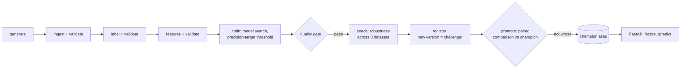

# FraudShield-MLOps

A production-style ML system for transaction fraud detection: from raw,
messy multi-format logs to a containerised, tested scoring API, reproducible
on any machine with one command.

Built milestone by milestone on top of the model from
[FraudShield V2](https://github.com/Hartyplaza/FraudShield_V2), which covers the
exploration and modelling. This repository is about the **engineering around the
model**: packaging, reproducibility, testing, containers, real-time scoring,
experiment tracking and data versioning, and (in later milestones) CI/CD,
monitoring and retraining.

## Quickstart

Requires only Git and Docker.

```bash
git clone https://github.com/Hartyplaza/FraudShield-MLOps
cd FraudShield-MLOps
docker compose up --build
```

This generates synthetic data, runs the full pipeline, trains the model, and
starts the API on `http://localhost:8000`. Interactive docs: `http://localhost:8000/docs`.

```bash
curl localhost:8000/health
# {"status":"ok","model_loaded":true,"threshold":0.9,"version":"0.1.0"}
```

## Architecture



| Stage | What it does | Output |
|---|---|---|
| generate | synthetic raw logs from config | `data/raw/logs.csv` |
| ingest | parse 7 formats, clean, **validate** | `data/interim/clean.csv` |
| label | deterministic fraud rules, **validate** (incl. fraud rate) | `data/interim/labelled.csv` |
| features | 27 leak-free features, **validate** | `data/processed/` |
| train | 4-model search, threshold by precision target, MLflow run | `models/`, `reports/metrics.json` |
| gate | metric limits, golden cases, invariance and directional checks | `reports/gate.json` |
| seeds | refit the recipe on 8 new datasets | `reports/seeds.json` |
| register | new registry version, alias `challenger` | `reports/registry.json` |

`uv run dvc repro` runs the stages in order and reruns only those whose inputs
changed. Any failed check stops the pipeline at that stage. Promotion to `champion`
is a separate, deliberate step (`fraudshield.registry.promote`), logged in
`reports/promotions.jsonl`.

In Docker, a **train** container runs the pipeline once and writes the model to a
shared volume. The **api** container starts only after training succeeds, and
mounts the model read-only.

## Results

Current model (M4): LightGBM, 27 features, threshold 0.90 (highest recall with
precision at least 0.90 on out-of-fold predictions).

| Metric | Training data (seed 42) | Across 8 new datasets (mean ± sd) |
|---|---|---|
| PR-AUC | 0.993 | 0.965 ± 0.019 |
| Recall | 0.967 | 0.905 ± 0.062 |
| Precision | 0.908 | 0.900 ± 0.044 |
| False positive rate | 0.40% | 0.39% ± 0.18% |

Live stream (2 unseen weeks): 72 of 75 frauds caught, 6 false alarms. The quality
gate passes 20 of 20 checks, and the score does not depend on log format or currency.

**Reproducibility:** identical models were produced in independent environments
(pip, `uv` on WSL2, Docker). Every training run is logged to MLflow with its git
commit and data hashes, and `dvc.lock` pins the exact data behind each commit.

## Local development

```bash
uv sync --all-extras                # install from the lockfile
RUN_NAME=my-run uv run dvc repro    # run the pipeline; only changed stages rerun
uv run dvc metrics show             # current metrics
make test                           # 104 tests
uv run mlflow ui --backend-store-uri sqlite:///mlflow.db   # browse runs
uv run uvicorn fraudshield.serving.api:app --port 8000
```

To keep the data, set up a DVC store once (any folder outside the repo):

```bash
uv run dvc remote add --local -d localstore ~/dvc-store
uv run dvc push      # save data and model
uv run dvc pull      # restore them
```

Model registry and promotion:

```bash
uv run python -m fraudshield.registry.promote                       # challenger vs champion
uv run python -m fraudshield.registry.promote --version 1 --force   # roll back to version 1
MODEL_URI=models:/fraudshield@champion uv run uvicorn fraudshield.serving.api:app --port 8000
```

## Project layout

```
src/fraudshield/
├── data/ synthetic log generator (7 formats)
├── ingestion/ multi-format parser + cleaner
├── labelling/ deterministic fraud rules
├── features/ 27 engineered features
├── training/ model search, oversampling, threshold tuning
├── evaluation/ metrics, quality gates, stream error analysis
├── explainability/ SHAP
├── validation/ data contracts (pandera)
├── registry/ MLflow registry: register, promote, resolve champion
├── serving/ FastAPI app + predictor
└── pipeline/ one CLI entry point per stage, MLflow tracking
configs/pipeline.yaml all paths and settings, incl. data contract and gate limits
configs/*_cases.yaml  golden and behaviour cases for the quality gate
dvc.yaml / dvc.lock   versioned pipeline and the exact data hashes
tests/ contract, generator, online-feature, validation, gate and API tests
```


## About the data

The original data came from a technical assessment and is not redistributed.
The pipeline runs on a **synthetic statistical twin** generated from config:
same 7 log formats, same noise rates, same field distributions. The generator
reproduces the original's parse rate (77% vs 77.7%) and fraud rate (3.9% vs 3.4%).

Fraud labels come from deterministic rules (see `labelling/`), so the model is
learning those rules back. The goal of this project is the system around the
model, not a claim about real-world fraud performance.

## Roadmap

| Milestone | Focus | Status |
|---|---|---|
| M1 | Reproducible build: packaging, generator, pipeline, Docker, tests | ✅ Done |
| M2 | Real-time scoring: online features, leak-free training, `/score` | ✅ Done |
| M3 | Experiment tracking and data versioning (MLflow, DVC) | ✅ Done |
| M4 | Data validation and ML-specific tests | ✅ Done |
| M5 | Model registry and promotion gates | ✅ Done |
| M6 | CI/CD and cloud deployment | Next |
| M7 | Monitoring and drift detection | |
| M8 | Automated retraining | |

Full write-up of each milestone, including problems hit and how they were
solved: **[docs/milestones.md](docs/milestones.md)**.

## Licence

MIT