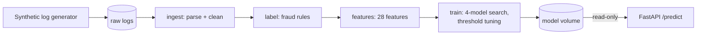

# FraudShield-MLOps

A production-style ML system for transaction fraud detection: from raw,
messy multi-format logs to a containerised, tested scoring API, reproducible
on any machine with one command.

Built milestone by milestone on top of the model from
[FraudShield V2](https://github.com/Hartyplaza/FraudShield_V2), which covers the
exploration and modelling. This repository is about the **engineering around the
model**: packaging, reproducibility, testing, containers, and (in later milestones)
experiment tracking, CI/CD, monitoring and retraining.

## Quickstart

Requires only Git and Docker.

```bash
git clone https://github.com/Hartyplaza/FraudShield-MLOps
cd FraudShield-MLOps
docker compose up --build
```

This generates synthetic data, runs the full pipeline, trains the model, and
starts the API on `http://localhost:8000`. Interactive docs: `http://localhost:8000/docs`.

```bash
curl localhost:8000/health
# {"status":"ok","model_loaded":true,"threshold":0.94,"version":"0.1.0"}
```

## Architecture



| Stage | Command | Output |
|---|---|---|
| Generate | `python -m fraudshield.data.generate` | `data/raw/logs.csv` |
| Ingest | `python -m fraudshield.pipeline.ingest` | `data/interim/clean.csv` |
| Label | `python -m fraudshield.pipeline.label` | `data/interim/labelled.csv` |
| Features | `python -m fraudshield.pipeline.features` | `data/processed/features.csv` |
| Train | `python -m fraudshield.pipeline.train` | `models/`, `reports/metrics.json` |

`make all` runs the stages in order and reruns only those whose inputs changed.

In Docker, a **train** container runs the pipeline once and writes the model to a
shared volume. The **api** container starts only after training succeeds, and
mounts the model read-only.

## Results

On generated data (seed 42), test set of 1,548 transactions:

| Metric | Value |
|---|---|
| Model | LightGBM |
| PR-AUC | 0.9468 |
| Recall | 0.869 |
| Precision | 0.883 |
| False positive rate | 0.47% |

**Reproducibility:** the identical model (same metrics, same confusion matrix
53/7/8/1480) was produced in three independent environments: a pip install,
a `uv` virtual environment on WSL2, and the Docker image.

## Local development

```bash
uv sync --all-extras      # install from the lockfile
make all                  # run the pipeline
make test                 # 35 tests
uv run uvicorn fraudshield.serving.api:app --port 8000
```

## Project layout
src/fraudshield/
├── data/ synthetic log generator (7 formats)
├── ingestion/ multi-format parser + cleaner
├── labelling/ deterministic fraud rules
├── features/ 28 engineered features
├── training/ model search, oversampling, threshold tuning
├── evaluation/ metrics
├── explainability/ SHAP
├── serving/ FastAPI app + predictor
└── pipeline/ one CLI entry point per stage
configs/pipeline.yaml all paths and generator settings
tests/ contract, generator and API tests


## About the data

The original data came from a technical assessment and is not redistributed.
The pipeline runs on a **synthetic statistical twin** generated from config:
same 7 log formats, same noise rates, same field distributions. The generator
reproduces the original's parse rate (77% vs 77.7%) and fraud rate (3.9% vs 3.4%).

Fraud labels come from deterministic rules (see `labelling/`), so the model is
learning those rules back. The goal of this project is the system around the
model, not a claim about real-world fraud performance.

## Roadmap

| Milestone | Focus | Status |
|---|---|---|
| M1 | Reproducible build: packaging, generator, pipeline, Docker, tests | ✅ Done |
| M2 | Experiment tracking and data versioning (MLflow, DVC) | Next |
| M3 | Data validation and ML-specific tests | |
| M4 | Model registry and promotion gates | |
| M5 | Serving: batch vs real-time, load testing | |
| M6 | CI/CD and cloud deployment | |
| M7 | Monitoring and drift detection | |
| M8 | Automated retraining | |

Full write-up of each milestone, including problems hit and how they were
solved: **[docs/milestones.md](docs/milestones.md)**.

## Licence

MIT